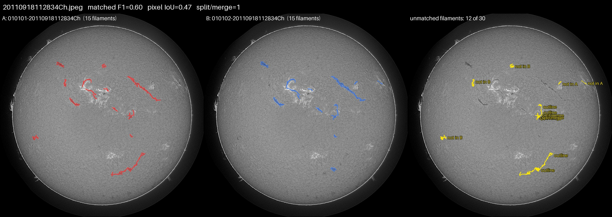
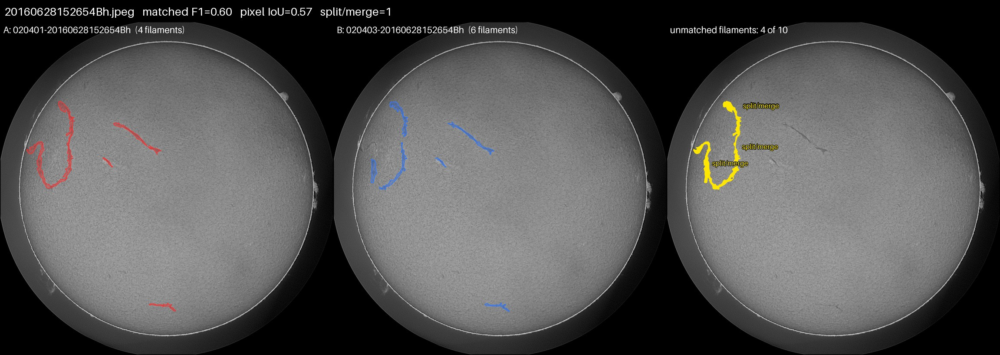
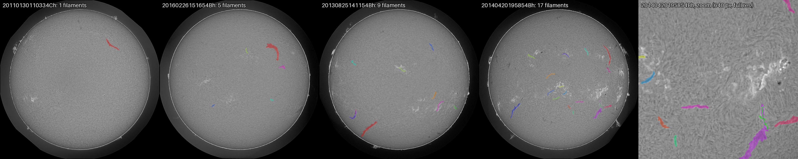

**Code, weights and reproducibility notebook:** https://github.com/blueclowd/solar_filaments_segmentation

## Abstract

We segment individual solar filaments in 2048×2048 full-disk H-alpha images (MAGFiLO) with a two-stage
pipeline. A YOLO11 detector proposes one box per filament; a U-Net with a ResNet-34 encoder then segments
the filament inside each box from a full-resolution crop, conditioned on a box mask channel. Instances are
assembled by confidence-ordered mask NMS. On a month-grouped validation split the pipeline reaches a
panoptic quality (PQ) of 0.448, against 0.403 for a single global U-Net with connected-component
post-processing; on the public leaderboard it scores 0.39 (global U-Net: 0.34). With ground-truth boxes the
same segmenter reaches PQ 0.686, so detection is the bottleneck. We show that this ceiling is largely set by
the labels: two annotators of the same image agree on only 58% of filaments at IoU > 0.5.

## 1. Problem and data

The task is class-agnostic instance segmentation: every filament must be returned as a separate mask, scored
by PQ with greedy matching at IoU > 0.5 (PQ = SQ × RQ, segmentation quality times recognition quality).
The training set has 707 grayscale images of 2048×2048 pixels from the GONG H-alpha network. Filament
classes (Left, Right, Unidentifiable chirality) are not scored and are merged into one class; spines and
other metadata are not used for training.

**Multiple annotators.** 296 of the 707 images were annotated independently by two or more people, giving
1,154 annotation sets in total. Following the organisers, each set is a complete, independent labelling. We
group sets by file name into one record per image, so an image never appears in both the training and the
validation split.

**Validation split.** Filaments persist for days, so neighbouring images are near-duplicates. We split by
calendar month (seed 42, 15% of images): 594 training images (962 annotation sets, 6,942 filaments) and
113 validation images (192 sets, 1,257 filaments). Each validation annotation set is scored as a separate
ground truth, and PQ is pooled over all of them.

**Object statistics.** Filaments are long, thin and sparse. At a 1024-pixel input the median box has a
short side of 26 pixels, 21% of boxes have a short side under 16 pixels, and a filament fills a median 20%
of its own bounding box.

## 2. Annotator disagreement

To understand the score ceiling we matched the annotation sets of every multi-annotator image against each
other with the competition's own rule (one-to-one greedy matching at mask IoU > 0.5). Of 4,086 filaments
drawn, only **58% have a match** in the other annotator's set. We classify each unmatched filament:

| Reason a filament has no match | Share of all filaments |
|---|---|
| Both annotators drew it, but outlines differ too much (IoU ≤ 0.5) | 14% |
| Drawn as a different number of pieces (split vs. merge) | 10% |
| Drawn by one annotator only | 17% |
| **Total unmatched** | **42%** |

Box-level agreement is similar (precision 0.615, recall 0.609 at box IoU > 0.5). A detector evaluated
against a single annotator therefore cannot be expected to exceed roughly 0.6 precision and recall, which
is exactly where our detectors saturate (Section 5).

**Consequence for training.** We keep one training sample per annotation set rather than fusing the
annotators. A filament drawn by one of two annotators is then a positive in half of the epochs and
background in the other half, so the detector learns a confidence of about 0.5 for it, while filaments
drawn by everyone are pushed towards 1. This is the calibration PQ needs when the test labels come from a
single annotator, and it is preserved better than with union labels (which would set every disputed
filament to 1) or majority labels (which would drop them). The tuned confidence threshold of 0.3 is
consistent with this: keeping a filament that about half the annotators would draw increases expected PQ.

## 3. Method

### 3.1 Baseline: global U-Net

Our first model segments all filament pixels at once: a U-Net (segmentation_models_pytorch) with an
ImageNet-pretrained ResNet-34 encoder adapted to one input channel and scSE attention in the decoder. It is
trained on 512×512 crops of images resized to 1024 (70% of crops centred on a filament), with BCE plus
batch-level soft Dice loss, AdamW, cosine schedule with warm-up, and mixed precision. Augmentation is
applied crop-first for speed: brightness, contrast and gamma through a 256-entry lookup table, and rotation,
scale, flips and cropping as a single affine warp evaluated only at output pixels. Instances are obtained
by thresholding, morphological closing, connected components, a minimum area, and merging components
closer than 12 pixels. This baseline segments pixels well but cannot separate touching filaments or join
broken ones reliably, which costs recognition quality.

### 3.2 Two-stage pipeline

**Stage 1 — detection.** An Ultralytics YOLO11 detector (single class) predicts one box per filament. It
is trained with one label file per annotation set, vertical and horizontal flips (valid once chirality
classes are merged), brightness jitter, no hue or saturation jitter (grayscale data), and no rotation.
The final model is YOLO11m at 1536-pixel input, 150 epochs, scale augmentation 0.25.

**Stage 2 — per-filament segmentation.** For each box we cut a window from the full-resolution 2048 image:
the box enlarged by 25% on each side, at least 48 pixels, with aspect ratio clipped to 2:1, resized to
256×256. The network input has two channels: the image crop and a binary mask of the box. The box channel
tells the network *which* filament to segment when several are in view. The target is that single
filament's mask. The model is the same ResNet-34 U-Net with two input channels, trained with BCE + Dice for
20 epochs. During training, ground-truth boxes are jittered (σ = 10% of the box side) so the network
tolerates imperfect detections. Working at full resolution preserves the thin structures that the
1024-pixel global model blurs.

**Instance assembly.** Boxes are processed from most to least confident. Each predicted mask is pasted
back into the 2048 frame; masks overlapping an already accepted mask by more than the NMS IoU are dropped
as duplicates, and pixels claimed by two filaments go to the higher probability. Masks smaller than the
minimum area are removed. Flip test-time augmentation is applied to each crop.

**Tuning.** The detector confidence threshold, mask threshold, mask-NMS IoU and minimum area are tuned on
validation by coordinate search, reusing cached per-box probabilities so each setting costs only the
assembly step. The chosen values (confidence 0.3, mask threshold 0.6, NMS IoU 0.3, minimum area 200
pixels) are stored in `configs/final_settings.json`.

**Final models.** After model selection, both stages are retrained on all 707 images (1,154 annotation
sets) with the same settings; the YOLO weights from the last epoch are used.

## 4. Results

### 4.1 Model comparison (validation, 113 images, 192 annotation sets)

| Method | PQ (pooled) | PQ (per image) | Public LB |
|---|---|---|---|
| Global U-Net, 10 epochs, threshold 0.7 | — | — | 0.32 |
| Global U-Net, 30 epochs (best epoch 18), threshold 0.8 | 0.403 | — | 0.34 |
| Two-stage, YOLO11s @ 1024 | 0.447 | 0.438 | 0.39 |
| Two-stage, YOLO11m @ 1536 | 0.448 | 0.441 | — |
| Two-stage, final models on all data | — | — | 0.38 |
| *Two-stage with ground-truth boxes (oracle)* | *0.686* | *0.683* | — |

The two-stage pipeline improves validation PQ by 0.045 over the global U-Net and the public score by 0.05.
The final models, retrained on all images, predict about 17% more filaments on the test set at the same
confidence threshold; raising it from 0.3 to 0.4 restores the earlier count but leaves the public score at
0.38, so we keep the validated setting. The 0.01 gap to the YOLO11s submission is within leaderboard
resolution (two decimals, partial test set).
The gain is mostly recognition quality: RQ rises from 0.605 to 0.650 and SQ from 0.666 to 0.690, and
merged filaments drop from 45 to 33 (global U-Net at threshold 0.8: 63 split, 45 merged).
Breaking down the best configuration: SQ 0.690, RQ 0.650. Of 1,257 ground-truth filaments (all 192
validation annotation sets), 762 are matched and 495 missed; there are 326 false positives, and 50 split
and 33 merged filaments.

### 4.2 Where the error is

With ground-truth boxes the segmenter reaches PQ 0.686 (SQ 0.711, RQ 0.965): given the right box it almost
always produces a mask that matches (IoU > 0.5). Replacing oracle boxes by detections drops RQ from 0.965
to 0.650 while SQ barely changes (0.711 → 0.690). The remaining gap is almost entirely detection. The
detector itself saturates at the inter-annotator level: YOLO11s at 1024 reaches precision 0.637, recall
0.647 (mAP50 0.673); a larger YOLO11m at 1536 raises precision to 0.671 but leaves recall at 0.642 and
end-to-end PQ unchanged (0.447 → 0.448). Both are close to the 0.61–0.62 agreement between two human
annotators.

### 4.3 Post-processing sensitivity

Coordinate search in the order listed; each row starts from the best values of the rows above
(initially mask threshold 0.5, NMS IoU 0.5, minimum area 200). YOLO11m at 1536.

| Setting varied | Values tried → PQ |
|---|---|
| Detector confidence | 0.1 → 0.367, 0.2 → 0.419, **0.3 → 0.436**, 0.4 → 0.424, 0.5 → 0.403 |
| Mask threshold | 0.4 → 0.431, 0.5 → 0.436, **0.6 → 0.438** |
| Mask NMS IoU | **0.3 → 0.448**, 0.5 → 0.438, 0.7 → 0.418 |
| Minimum area (px) | 100 → 0.448, **200 → 0.448**, 300 → 0.447 |

The detector confidence trades false positives against false negatives and matters most. A low mask-NMS
IoU removes overlapping duplicate detections of the same filament and reduces splits from 116 to 50.

### 4.4 Loss ablation (per-filament model, oracle PQ on validation)

| Loss | Oracle PQ |
|---|---|
| BCE + Dice (two independent runs) | 0.6975 / 0.6963 |
| BCE + Dice + Lovász hinge | 0.6981 |
| BCE + Dice + clDice | 0.6839 |

The two baseline runs differ by 0.001, which sets the run-to-run noise level. Lovász hinge, which
directly optimises IoU, stays within about twice that noise of the baseline: no measurable gain. clDice, designed for thin tubular
structures, hurts: it rewards a continuous centreline, but annotators draw filaments as loose, wide bands,
and PQ measures overlap with those bands. We keep BCE + Dice.

### 4.5 Efficiency

| Stage | Hardware | Time |
|---|---|---|
| YOLO11m training, 150 epochs, 962 sets | 2× T4 (Kaggle) | 3.66 h |
| YOLO11m training, 150 epochs, 1,154 sets | 1× A10 | 3.08 h |
| Per-filament U-Net training, 20 epochs, 594 images | 1× T4 | ≈ 22 min (66 s/epoch) |
| Per-filament U-Net training, 20 epochs, 707 images | 1× A10 | ≈ 11 min (33 s/epoch) |
| Global U-Net inference incl. flip TTA | 1× T4 | 0.45 s / image |
| Two-stage inference incl. flip TTA (180 test images) | 1× A10 | 0.31 s / image |

The per-filament model trains quickly because each sample is a 256×256 crop rather than a 512×512 region
of a mostly empty disk, and every sample contains a filament.

### 4.6 Qualitative results

Masks follow the dark filament material of clearly visible filaments, including long curved ones near
the limb, and neighbouring filaments are kept as separate instances. Two failure modes are visible.
First, thin side branches or the faint end of a large filament are sometimes returned as extra small
instances next to the main mask (lower right of the zoom), which costs a false positive or a split.
Second, short dark lanes inside bright active regions (plage) are occasionally detected as filaments.
Both are among the cases where annotators themselves disagree most (Section 2).

## 5. Discussion

**What worked.** Separating *where* a filament is from *what shape* it has. The detector resolves
instance identity (split and merge decisions), and the segmenter works at full resolution on one object
at a time, guided by the box channel. This raised validation PQ from 0.403 to 0.448.

**What did not.** A larger detector and input size (YOLO11m at 1536 instead of YOLO11s at 1024, about
4× the training cost) gave no end-to-end gain. Thin-structure and IoU losses did not help the segmenter.

**Limits.** Our analysis indicates that about 42% of filaments are not reproduced between two annotators at
the competition's matching threshold. The resulting detector precision/recall of roughly 0.6–0.65 matches
human agreement, so further gains against a single annotator's labels are limited without additional
information about which annotation style the test labels follow.

**Possible extensions.** Oriented boxes (YOLO11-obb) would fit long diagonal filaments more tightly;
ensembling detectors (weighted box fusion) could add recall; temporal context from adjacent days could
help faint filaments, but would conflict with the rule that inference uses only the test image.

## 6. Reproducibility

The repository contains `requirements.txt`, the training and inference code (`filseg/`, `train_yolo.py`,
`train_instance.py`, `predict_instances.py`), the tuned settings (`configs/final_settings.json`), the final
weights, and a notebook that reproduces the test predictions from the stored weights without retraining.
Full retraining on all data: `scripts/run_final.sh`. The annotator analysis in Section 2:
`visualize_disagreement.py`.
